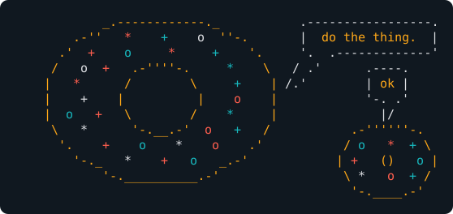
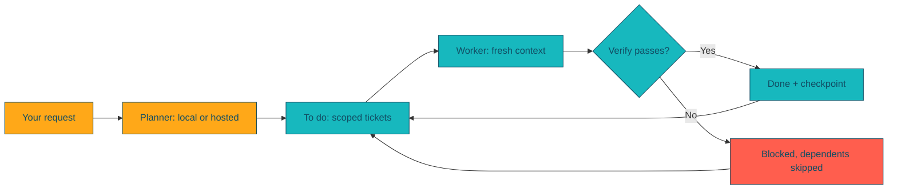

<p align="center">
  
</p>

<h1 align="center">Donut</h1>
<p align="center"><strong>Your planning model writes the tickets. Your worker model takes them one at a time. Do the thing.</strong></p>

<p align="center">
  <a href="https://github.com/ihawn/Donut/actions/workflows/test.yml"></a>
  <a href="https://github.com/ihawn/Donut/actions/workflows/release.yml"></a>
  <a href="https://github.com/ihawn/Donut/releases/latest"></a>
  <a href="https://github.com/ihawn/Donut/blob/main/pyproject.toml"></a>
  <a href="#install"></a>
</p>

<p align="center"><a href="#install">Install</a> · <a href="#thirty-seconds">Thirty seconds</a> · <a href="#why">Why</a> · <a href="#what-you-get">What you get</a> · <a href="docs/reference.md">Reference</a></p>

---

Big models are great at understanding a codebase and terrible value for typing out the hundredth small edit. Small local models are the opposite: cheap and fast, but they lose the plot in a large context. Donut splits the job. A **planner** (Claude, Codex, or anything local) researches your project and writes small, self-contained tickets. A **worker** (often a local Ollama model) picks them up one at a time, each in a fresh context, with the exact files, steps and checks it needs.

**Works with:** Ollama · Qwen Code · Claude Code · Codex · any OpenAI-compatible endpoint, including Grok.

## Install

```sh
curl -fsSL https://raw.githubusercontent.com/ihawn/Donut/main/install.sh | sh
```

```powershell
curl.exe -fsSL https://raw.githubusercontent.com/ihawn/Donut/main/install.ps1 -o "$env:TEMP\donut-install.ps1"
if ($LASTEXITCODE -eq 0) { powershell -NoProfile -ExecutionPolicy Bypass -File "$env:TEMP\donut-install.ps1" }
```

The installer uses [uv](https://docs.astral.sh/uv/) to put Donut and Python 3.13 in an isolated environment. Install the provider CLIs you plan to use (Qwen Code for local and OpenAI-compatible models, Claude Code, Codex) and, for local inference, run an Ollama server. Run the installer again to upgrade; your settings are kept.

## Thirty seconds

```sh
cd your-project
donut setup                 # pick a planner, pick worker models, choose a default worker
donut                       # open the terminal
```

Inside the terminal:

```
/plan   Add rate limiting to the public API, 100 requests per minute per key
/work   next 1
```

`/plan` has the planner read your code and write tickets into this session's `.donut/<session>/to_do/`. `/work next 1` hands the next eligible ticket to the worker in a fresh process. Add `checkpoint` to get a git commit after every ticket, so a bad one is a single revert away:

```
/work   next all checkpoint
```

Everything also works without the terminal:

```sh
donut --plan "Add rate limiting"             # one planning request
donut --work next 3 --checkpoint             # three tickets, a commit after each
donut -m fast-local --work -p ../other-app   # choose the worker alias and the project
```

## Why

- **Fresh context per ticket.** The worker never carries the whole project, or the last ticket's mistakes, into the next one.
- **Tickets are files.** Plain Markdown in `.donut/<session>/{to_do,in_progress,on_hold,blocked,done}/`, one folder per session, so separate lines of work never share a queue. Read them, edit them, commit them, diff them.
- **Donut checks the work, not just the story.** A ticket can carry a `**Verify:**` command. Donut runs it itself after the worker finishes; if it fails, the worker gets the output and two tries to fix it, then the ticket is moved to `blocked/` and nothing that depends on it runs.
- **A safety net you can see.** With `--checkpoint`, every ticket ends in a git commit. Every run records which files changed, in logs kept outside your repository.
- **Several tickets at once.** `--parallel 3` works independent tickets side by side, each in its own git worktree, and brings each back as one commit.
- **A second model on standby.** Give the worker a `fallback` alias and a provider outage or rate limit hands the run to it instead of stopping.
- **Nothing silently stuck.** When the queue cannot continue, Donut says which tickets are waiting, on what, and which ones have broken metadata, instead of just stopping.
- **Your keys stay yours.** Configuration stores model aliases and environment variable *names*. Provider CLIs own their own logins.

## What you get



| Plan once | Work in small steps | See what happened |
|---|---|---|
| The planner reads your project and writes tickets with exact files, steps, tests and acceptance criteria. | Each ticket gets its own process, its own context, a Verify command and completion notes. | Streamed output, a per-run summary table, and results and logs under `~/.local/state/donut`. |

The interactive terminal wraps all of this with an inline slash-command menu (type `/`, arrow to a command, press Enter), model and ticket pickers, permission prompts and rendered Markdown. `/solo` skips the planner entirely and talks to a model directly, like Claude Code, and `/review` asks the reviewer to check code without editing it. `/planner`, `/worker`, `/reviewer` and `/soloist` pick each role's model. `/resume` reopens an earlier conversation in the mode, model and tickets session it used, `/session` switches sessions, and `/project` opens another project in a new window. `!command` runs a shell command and shows the model its output, and a model left waiting on a background process is woken when it finishes. Drag to select and copy any output, and click links to open them. **Enter** sends, and messages sent mid-turn are queued. **Shift+Tab** or `/auto` switches to auto mode, where each provider's own reviewer approves safe actions. **Shift+Enter**, **Alt+Enter** or **Ctrl+J** insert a newline. **Ctrl+C** cancels the running turn and **Ctrl+Q** quits. Installed plugin and skill commands, such as [Ponytail](https://github.com/DietrichGebert/ponytail)'s `/ponytail-review`, are in the same menu for every provider, and Ponytail's task numbers (cost, turns, agent time, tokens, tests) show under the prompt and go to its board. For anything a provider only offers in its own client, `/native` drops you into it and brings you back.

Not everyone wants planners and tickets. The first time Donut opens it asks whether you want simple or complex mode. Simple mode is one conversation, like Claude Code or Codex, where Donut rates each new request from 1 to 10 and picks the cheapest model that can handle it. `/harder` moves up a model, and `/complex` shows everything. See [Simple mode, complex mode and auto](docs/reference.md#simple-mode-complex-mode-and-auto).

Two sets of accounts on one machine, such as a company account and a personal subscription? `donut --profile NAME` keeps each one's accounts, conversations and tickets apart, and a project can list the profiles allowed to open it. See [Profiles](docs/reference.md#profiles).

> Subjective acceptance checks stay yours to verify, and a failed or blocked ticket is reported, never papered over. Only run unattended workers in projects you trust and have under version control.

## Going further

The **[reference](docs/reference.md)** covers every command and flag, the setup walkthrough, ticket format and lanes, provider details, run logs, releases and contributing. For development:

```sh
python3 -m venv .venv && .venv/bin/pip install -e . ruff
.venv/bin/python -m unittest discover -s tests -v
.venv/bin/ruff check . && .venv/bin/ruff format --check .
```
