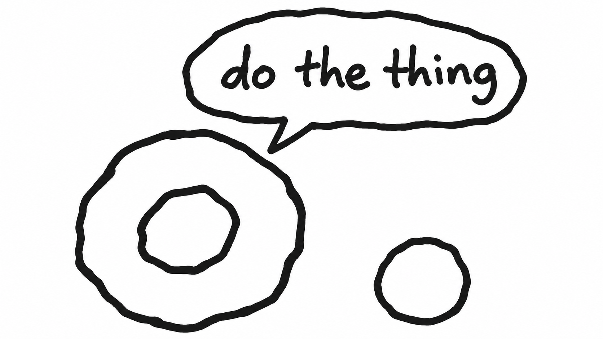
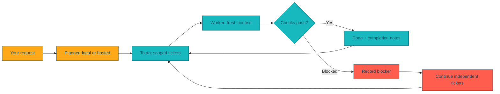

<p align="center">
  
</p>

<h1 align="center">Donut</h1>
<p align="center"><strong>Your planning model writes the tickets. Your worker model takes them one at a time. Do the thing.</strong></p>

<p align="center">
  <a href="https://github.com/ihawn/Donut/actions/workflows/test.yml"></a>
  <a href="https://github.com/ihawn/Donut/actions/workflows/release.yml"></a>
  <a href="https://github.com/ihawn/Donut/releases/latest"></a>
  <a href="https://github.com/ihawn/Donut/blob/main/pyproject.toml"></a>
</p>
<p align="center">
  <a href="#install"></a>
  <a href="https://github.com/ihawn/Donut/stargazers"></a>
  <a href="https://github.com/ihawn/Donut/commits/main"></a>
  <a href="https://github.com/ihawn/Donut/blob/main/pyproject.toml"></a>
</p>

<p align="center"><a href="#install">Install</a> · <a href="#quick-start">Quick start</a> · <a href="#how-it-works">How it works</a> · <a href="#setup">Models & setup</a> · <a href="#releases">Releases</a> · <a href="#development--verification">Contribute</a></p>

---

Donut is built primarily for **a smarter model orchestrating a less capable local model through hyper-focused tasks**. The planner researches your code and turns the work into small tickets with exact files, clear boundaries and verifiable checks. The local worker tackles one ticket at a time in a **fresh context**, so it can focus on a manageable job without carrying the whole project in its context window.

Donut wraps the coding agents you already use. Mix providers, use one model for both roles, or keep the entire workflow local; the primary workflow pairs a stronger planner with a smaller local worker.

| 🟠 Plan once | 🟦 Work in small steps | 🟢 See what happened |
|---|---|---|
| A planner researches your project and writes scoped tickets. | Each ticket gets its own process, context, tests and completion notes. | Live agent output, loading indicators and a compact run summary. |

**Works with:** Ollama · Qwen Code · Claude Code · Codex · OpenAI-compatible endpoints, including Grok.

## Quick start

After [installing](#install), open your project and choose your models:

```sh
donut setup
donut --plan                     # interactive planner; describe what you want
donut --work next 1              # execute one eligible ticket
```

`planner` and `worker` are aliases **you choose during setup**, not built-in model names.

```sh
donut -v                          # installed version (also --version)
donut models                      # your configured aliases
donut -m worker --work        # all eligible tickets, one fresh context each
donut -m worker --work next 1 -p ../app # work in another project
donut -h                          # all commands
```

## How it works



> **You stay in control.** Model aliases and credentials stay outside the repo. Existing project instructions are preserved. A failed or blocked task is reported; subjective acceptance checks stay yours to verify.

## Install

Install the latest GitHub Release with curl. The installers use [uv](https://docs.astral.sh/uv/getting-started/installation/) to install Donut and Python 3.13 in an isolated environment; no preinstalled Python or Git is required.

**macOS / Linux**

```sh
curl -fsSL https://raw.githubusercontent.com/ihawn/Donut/main/install.sh | sh
```

**Windows (PowerShell)**

```powershell
curl.exe -fsSL https://raw.githubusercontent.com/ihawn/Donut/main/install.ps1 -o "$env:TEMP\donut-install.ps1"
if ($LASTEXITCODE -eq 0) { powershell -NoProfile -ExecutionPolicy Bypass -File "$env:TEMP\donut-install.ps1" }
```

Installation finishes with the ASCII donut welcome screen, installed version and next steps. The same logo appears during setup. Preview it anytime with `donut welcome`.

Open a new terminal after installation:

```sh
cd your-project
donut setup
```

Run the same installer again to upgrade to the latest release; your aliases and settings are preserved. Check the installed version with `donut -v`. Install the provider CLI(s) you intend to use: Qwen Code for Ollama and compatible endpoints, Claude Code for Claude, or Codex for OpenAI. Local inference also requires a running Ollama server. Donut does not silently install provider tools or models.

For development: `python3 -m venv .venv`, `.venv/bin/pip install -e .`, then `.venv/bin/donut`.

## Setup

`donut setup` uses numbered choices and three steps: choose a planner, add worker models, and choose a default worker. Existing aliases are shown and preserved; local models can be selected together by number. It walks through:

1. Choosing a local or hosted planning/orchestration provider. Select `ollama` for a local model with no cloud login, or a hosted provider. Claude/Codex can open their own login flow or reuse an existing login. Grok/compatible endpoints use a named environment variable containing an API key; Donut never asks you to paste that key into its configuration.
2. Naming aliases. Each alias selects its engine, model, and optional compatible endpoint. A hosted model can be the worker too.
3. Discovering registered Ollama models and model files under `~/Models`, `~/Downloads`, `~/.cache/huggingface/hub`, `~/.lmstudio/models`, and `~/.ollama/models`. `--scan PATH` instead scans a directory you choose. It inspects filenames, not personal document contents.
4. Optionally importing a discovered GGUF into Ollama. Safetensors directories are reported; serve these with a compatible runtime before configuring an endpoint. A raw weight file is not necessarily a runnable coding model.
5. Installing project instructions and selecting the default worker.

Setup asks whether each cloud alias may execute tools without approval. Local aliases retain the original Qwen worker's unattended mode. Only run unattended agents in projects you trust. Without automatic approval, a provider may refuse commands it cannot approve non-interactively; Donut reports the failure instead of claiming completion.

```sh
donut models
donut discover --scan /path/to/models
donut setup -p ../another-project
```

Configuration is user-local: `$XDG_CONFIG_HOME/donut/config.json` (default `~/.config/donut/config.json`, mode 0600). It contains aliases and **environment variable names**, never API key values. Provider CLIs own their own OAuth credentials. Claude setup explicitly selects its login/configuration folder (for example `~/.claude` or `~/.claude-personal`); that folder is used for both login and execution. Setup also offers simple shell aliases from `.zshrc`, `.bashrc`, and `.bash_profile`, including `claude-personal` defined with `CLAUDE_CONFIG_DIR`. Selecting one imports its login folder without executing shell startup code. Existing Donut aliases take precedence. Shell functions, aliases with extra flags or commands, and dynamically constructed paths are not imported; use the provider/login-folder choices for those. Naming a new Donut alias alone does not select an account. Subscription login and API billing are different; Grok uses API authentication here, not a browser-chat subscription.

## Plan and build

```sh
donut --plan                     # interactive session
donut -m qwen --plan "Add wall jumping"  # local orchestrator
donut -m qwen-faster --work next 3
donut -m qwen --work
donut -m cloud-worker --work next 1 --project ../another-project
```

Setup ends with **SETUP COMPLETE** and **Try running `donut --plan`**. Run that command to open an interactive planning prompt in your current terminal. Donut installs the project skills and creates `swim_lanes/to_do/`, `in_progress/`, and `done/`; the planner researches your requests and writes tickets into `to_do/`. Its available thinking, tool activity, and answers stream as it works. After each successful prompt it prints **PLANNING COMPLETE** and **Try exiting the shell and running `donut --work next 1`**, then accepts another prompt. Enter `/exit` or `/quit`, or send EOF (Ctrl-D on macOS/Linux; Ctrl-Z then Enter on Windows), to leave.

Each planning prompt starts a new agent process with earlier requests and a reference to the previous output log for follow-ups; the project files and tickets preserve the plan. `donut --plan "a request"` runs one prompt and exits. A failed prompt reports **PLANNING FAILED** instead of completion.

`donut --work next 1` processes exactly one eligible ticket (or none when no ticket is eligible), then prints the run summary. Use `donut --work next 3` for up to three tickets or `donut --work next all` for all eligible tickets. Each ticket gets a fresh worker context. Bare `donut --work` still runs all eligible tickets, and the shorter `donut --work 3` form remains supported. The older `donut plan "request"` and `donut do next COUNT` forms remain compatible.

`-m` / `--model` accepts a configured alias for either planning or execution. The planner/orchestrator and worker may be the same local model, different local models, or hosted models. Setup stores a default planner separately from the default worker. `-p` / `--project` accepts an absolute or relative directory and defaults to the current directory. Flags work before or after the subcommand. `donut -h` lists commands.

`donut init` and `donut add-skills` install skills without login/setup. Existing instructions and skills are kept. They create:

- `swim_lanes/{to_do,in_progress,done}/`
- `.qwen/skills/swim-lane-worker/SKILL.md`, connected through `QWEN.md`
- `skills/donut-planner/SKILL.md`, explicitly loaded by `donut --plan` (including Codex), plus Claude/Cursor skill copies
- Relevant locally available Unity skills when a Unity project is detected

No game-specific rules are copied from another project. If this project has `skills/project-rules/SKILL.md`, its worker import is connected. Planner instructions are deliberately not placed in `AGENTS.md` or `.agents/skills`, since Qwen also reads those locations.

## Execution and output

Each ticket gets a fresh process with no resume/continue flag. Existing in-progress work is considered first, then the lowest numbered eligible ticket. Dependencies use `**Slug:**` and `**Depends on:**` metadata. A blocked ticket counts toward the requested number; its dependent tasks are skipped, while independent tasks can continue. `all` rechecks the queue, including newly added tickets. Process failure or an invalid lane transition stops the batch.

Donut uses an orange/navy/coral/teal/gray palette, a loading spinner while the agent is silent, and live emitted text, reasoning, tools, and results. Redirected output has no color and prints periodic status lines. Set `NO_COLOR=1` to disable colors. Some providers expose reasoning summaries or only complete events; Donut cannot display reasoning they do not expose.

The legacy `qwen build next …` and `qwen-faster build next …` batch entry point can also use this runner through the installed `qwen-build-next` compatibility command.

Streamed output labels identify the configured model (or the provider-reported model when available). Fenced code and inline snippets are highlighted using the Donut palette. In thinking and prose, backtick snippets are orange, numbers are coral, parentheses/braces are teal, and error messages are coral/red; code lines are buffered across token chunks for consistent coloring. `NO_COLOR` and redirected output remain plain, as do saved logs. The lightweight highlighter handles common tokens rather than full language grammars.

The final summary is a compact Task / Result / Note table covering only tickets attempted during this run. It hides summary reasoning and excludes untouched queue entries. It is produced by another fresh agent context using completion notes. Donut checks lane transitions, not the truth of model-authored tests. Human checks remain human checks. Codex's summary context is read-only; Claude disables tools and Qwen sets its tool-call budget to zero.

Run logs/results live outside the repo under `$XDG_STATE_HOME/donut` (default `~/.local/state/donut`). They can contain project content and tool output, so treat them as private. Ctrl-C terminates the current process group and prevents the next ticket from starting. Re-running resumes unfinished work in a fresh context. Per-project locks stop overlapping Donut batches, but cannot stop manually launched agents or the older Qwen wrapper.

For Ollama, Donut unloads other loaded models before activating the chosen model and refreshes its one-hour keepalive after the batch. Configure `OLLAMA_KEEP_ALIVE=1h` on the **Ollama server** for the same timeout on requests made by provider clients and on interrupted runs. Donut does not rewrite OS service configuration. Hosted model residency is controlled by the provider.

## Development / verification

```sh
python3 -m unittest discover -s tests -v
python3 -m donut --help
```

Tests use fake agent executables and temporary projects; no credentials or paid model calls are needed. They cover dependency ordering, blocked tasks, process errors, locking, fresh invocations, output rendering, setup, model discovery, instruction preservation, credential boundaries and provider command construction.

macOS, Windows and Linux are supported and tested in CI, including the shell/PowerShell installers. No remote accounts, API keys, user configuration, or run logs belong in this repository.

## Releases

The [Release workflow](https://github.com/ihawn/Donut/actions/workflows/release.yml) runs the complete macOS/Windows/Linux unit-test and installer matrix, builds a wheel and source distribution, checks package metadata, and smoke-tests the installed wheel in a clean directory (including the bundled skills).

Every merge into `main` triggers this pipeline and publishes a GitHub Release after the checks pass. Direct pushes to `main` also trigger it. Pull requests run unit tests without publishing. Manual workflow runs validate and produce downloadable artifacts without publishing.

The first release uses `version` in `pyproject.toml`. Subsequent releases automatically increment the highest stable release's patch version. To start a new minor or major series, raise the version in `pyproject.toml` in your PR; it serves as the minimum release version. CI stamps the selected version into the built packages without making a bot commit to the repository. Re-running an already tagged commit reuses its version.

Successful main runs create the version tag and publish the wheel, source distribution and `SHA256SUMS` using GitHub's built-in token; no additional release secret is needed. Re-running the same release updates its assets. This publishes to GitHub Releases, not PyPI.

The README graphic is a deliberately rough black-and-white donut doodle, without faces or frosting.

Installer CI uses `DONUT_INSTALL_SOURCE` to test the just-built wheel before a release exists; normal installations resolve the latest public GitHub Release.
