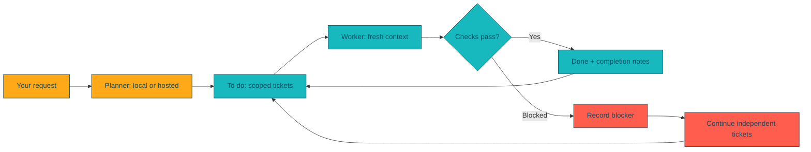

# Donut reference

Everything the [README](../README.md) leaves out: the terminal, setup, planning and working, ticket format, output, releases and contributing.

## Interactive terminal

Run `donut` in your project. The terminal supports multiline editing, paste, mouse-operated searchable menus, rendered Markdown/code, streaming responses, thinking indicators, approval dialogs and clipboard copy (`/copy`, subject to terminal support). Enter sends. Shift+Enter, Alt+Enter or Ctrl+J insert a newline (Ctrl+Enter also sends in terminals that can tell it apart from Enter, such as kitty, WezTerm, Ghostty and Windows Terminal; most others cannot, which is why Enter is the send key). Ctrl+C cancels the running turn and Ctrl+Q exits. F2 opens models; F3 switches modes.

Type `/` and a command list appears inline above the prompt, the way Claude Code does it. Keep typing to filter, Up and Down move the highlight, Enter runs the highlighted command, Tab completes it so you can add arguments, and Escape closes the list. Typing a space closes it too, so `/work next 3` followed by Enter sends the whole line. Pickers such as `/model` and `/work`, and tool permission prompts, use the same inline list instead of opening a separate window.

- **Modes and roles.** Donut has four roles, each with its own model, and a mode for each:

  | Pick the model | Enter the mode | What the mode does |
  |---|---|---|
  | `/planner` | `/plan` | Messages go to the planner, which researches and writes tickets. |
  | `/worker` | `/work` | Runs tickets: `/work next 1`, `/work next all`, `/work next 3 checkpoint` (a git commit after each ticket). |
  | `/reviewer` | `/review` | Messages go to the reviewer, which reads the project and never edits it. The reviewer also checks each finished ticket during `/work`. |
  | `/soloist` | `/solo` | Messages go to the soloist exactly as typed, like Claude Code: no planner, tickets, review or recovery. |

  The picker commands list every model each configured account offers, and change only their own role. Entering a mode asks for its model only when none is set. The planner and worker come from setup, and the reviewer defaults to the same model as the planner. The soloist has no default, so the first `/solo` asks. `/reviewer` also offers "Same as planner" and Off; a chosen reviewer stays put when the planner changes. `/model` picks the model for the current mode. Every choice, alias and model, is saved and comes back next time, and `donut --plan` and `donut --work` use the saved planner, worker and reviewer. Review and solo keep conversations of their own, apart from the planner's, even on the same model; review mode runs read-only (Claude plan mode, Codex read-only sandbox, Qwen plan mode). F3 cycles plan, work, review and solo.
- `/usage` shows each connection's available usage. Codex account rate limits are queried from its app server. Claude exposes session tokens and reported cost here; subscription quotas require native Claude `/usage`. Unavailable figures are identified explicitly.
- `/plugin`, `/mcp`, and `/context` inspect selected-provider capabilities. Claude plugin slash commands are discovered from the native engine and can be invoked directly. Codex uses its native plugin inventory and MCP status interfaces.
- Installed plugin and skill commands appear in the `/` menu from the start, before any session is open: Claude Code plugins enabled in the login's `settings.json` (and the project's `.claude/settings.json`), plus `skills/` and `commands/` in the login and project folders, and Codex plugins in `$CODEX_HOME/plugins` and skills in `$CODEX_HOME/skills`. Type them the same way for every provider; Donut sends `/name` to Claude Code and rewrites it to `$plugin:name` for Codex.
- **Ponytail.** With [Ponytail](https://github.com/DietrichGebert/ponytail) installed for the current mode's login, its commands (`/ponytail [lite|full|ultra|off]`, `/ponytail-review`, `/ponytail-audit`, `/ponytail-debt`, `/ponytail-gain`, `/ponytail-help`) work as they do in Claude Code or Codex, and its hooks run in Donut's sessions. Its band, a Claude Code UI module, is replaced by Donut's own line under the role line: level, cost (Claude only), turns, agent time, tokens and the last test run, for the current mode's conversation. After each turn Donut writes the same task row to Ponytail's ledger, `~/.config/ponytail/band/<project>.csv` (`$XDG_CONFIG_HOME` respected), so Donut's tasks show on Ponytail's board the next time the board is built. Reuse and open-caller counts come from Claude Code's edit hooks and are left empty. `/ponytail band [on|off]` shows or hides Donut's line; `/ponytail band import` stays in Claude Code (`/native`). `/clear` and `/new` start a new task row, as `/clear` does in Claude Code.
- `/native` suspends Donut and opens the selected provider's original interactive client, preserving its account/model selection. Use it for native plugin installation, provider-only built-ins, and interactions that Donut cannot yet render. Exit the client to return to Donut.
- `/permissions` picks how much the agent may do without asking, and `/auto` turns auto mode on or off. Shift+Tab cycles Ask, Accept edits and Auto, as in Claude Code. The choice is saved and applied to every provider through its own mechanism:

  | Mode | Claude | Codex | Qwen |
  |---|---|---|---|
  | Ask | `default` permission mode | `untrusted` approvals, workspace-write sandbox | `default` (behaves as Accept edits, since Qwen cannot show prompts inside Donut) |
  | Accept edits | `acceptEdits` | `on-request` approvals, workspace-write sandbox | `auto-edit` |
  | Auto | `auto`, a classifier approves or blocks each call | `auto_review` reviewer subagent; `--approve-for-me` for workers | `auto`, an LLM classifier |
  | Full access | `bypassPermissions` | `never` approvals, no sandbox | `yolo` |

  A live Claude session switches mode immediately when idle; Codex applies the new policy from the next turn; Qwen starts each turn with it. `/work` passes the mode to its workers. Unattended workers cannot answer prompts, so Ask runs them as Accept edits.
- Permission prompts appear inline above the prompt with the command or file diff. Press 1 to allow once, 2 to allow that kind of action for the rest of the session, 3 or Escape to deny.
- Messages sent while a turn is running are queued and sent when it finishes, like Claude Code. Commands that only show something (`/usage`, `/help`, `/copy`, `/context`, `/mcp`, `/plugin`, `/verbosity`, `/ponytail band`) run at once instead; mid-turn, `/usage` shows the latest figures, which refresh when the turn ends. Ctrl+C cancels the turn and puts queued messages back in the prompt. Free-form messages always go to the planner, including right after `/work`.
- `/resume` lists this project's earlier conversations, newest first, each with its mode, model, when it was last used and how many turns it has. Choosing one switches to its mode and sets that role's model to the one it used (and saves that choice), reopens the provider's own session (Claude `--resume`, Codex `thread/resume`, Qwen `--resume`) so the model has the full history, and shows the last few messages as a recap. Plan, review and solo conversations are saved after each turn in `$XDG_STATE_HOME/donut/conversations.json` (default `~/.local/state/donut`), readable only by you, since they hold project content; `/clear` starts a new one.
- **Sessions.** Each Donut window works from its own tickets folder, `.donut/<session>/{to_do,in_progress,on_hold,blocked,done}/`, named after the time it opened (`.donut/20261109-1712/`) and made the first time it plans or works. The welcome screen and the status line show it. `/session` lists this project's sessions with their ticket counts and switches the window to one, `/session new` starts an empty one, and `/session NAME` switches to or creates that name. Projects from before sessions keep their tickets in `swim_lanes/`, which `/session` also offers. Each saved conversation records its session, so `/resume` switches back to the right tickets. `.donut/skills/` holds the worker skill and is never a session. `/rename NAME` names the session, and its tickets folder moves to `.donut/NAME/`, with spaces and other unsafe characters turned into dashes (`fix login bug` becomes `.donut/fix-login-bug/`); a name already taken gets `-2`. With Claude, Claude Code's own `/rename` runs (it can also make a name up) and the folder follows the name it reports. The session name titles the terminal window and tab (`fix-login-bug · my-project · Donut`), so windows are easy to tell apart in the tab bar and the window switcher, and shows in the status line; the terminal's own title comes back when Donut exits.
- `/project` lists the other projects Donut has opened or held conversations in, newest first, and opens the one you pick in a new terminal window, running Donut there. `/project PATH` opens any folder. The window is a new tmux window inside tmux; otherwise Terminal (or iTerm, when Donut runs in iTerm) on macOS, Windows Terminal or a new console on Windows, and `$TERMINAL` or the first of `x-terminal-emulator`, `gnome-terminal`, `konsole`, `kitty`, `alacritty`, `wezterm` and `xterm` on Linux. When none is found, Donut prints the command to run instead.
- **One conversation across modes and models.** Everything said in a Donut window is shared: plan, review and solo, whatever model answered. Before a model's next message, Donut gives it what happened elsewhere since its last turn (each exchange labelled with its mode and model, and the tools used), and a model joining for the first time gets everything so far; its own turns are never repeated, since its provider keeps those. Switching a role's model on the same login keeps the live session (Claude switches models in place, Codex from the next turn of the same thread), so nothing needs handing over; another provider or login gets the history this way and the old session is closed. The newest 100,000 characters are kept if it runs longer. A conversation reopened with `/resume` adds its saved recap. `/clear` and `/new` start over.
- **`/effort [LEVEL]`** sets how hard the current mode's model thinks, in its provider's own terms. For Claude it is **effort**, offering only the levels the selected model takes (Claude Code's own model list: `low`, `medium`, `high`, `xhigh`, `max`, with the SDK's descriptions), and it changes the live session at once. For Codex it is **reasoning effort**, with that model's own levels and descriptions from Codex, from the next turn. Qwen Code has no such setting, so `/effort` says so for local models. The choice is saved per role, shown after the model in the status line (`planner opus · max`), and passed to `/work` workers (`--effort` for Claude, `model_reasoning_effort` for Codex).
- **`/verbosity`** chooses how much of the models' work you see, for every role: planner, reviewer, soloist and the workers `/work` runs. It changes only the display, never what a model does or thinks, and it is saved. **Quiet** shows only each turn's final message. **Normal** (the default) shows the model's messages as it works. **Verbose** adds a line for every tool call (`⏺ Bash  git status`) and one for each result (its line count, or the error in coral). **Full** adds the model's thinking and up to 20 lines of each tool's output. `/verbosity LEVEL` sets it directly, and the status line shows it when it is not Normal. Run logs always keep everything.
- The transcript stays at its end while a reply streams, however tall the reply area above the prompt grows. Scroll up with the mouse wheel to read back, and new output no longer pulls the view down until you scroll back to the end.
- **Selecting and copying.** Drag over any output to select it. It is copied as soon as you release the mouse, through the terminal (OSC 52) and this computer's own clipboard tool (`pbcopy`, `clip`, `wl-copy`, `xclip` or `xsel`), so it works in terminals without OSC 52 such as macOS Terminal. Ctrl+C with a selection, in the output or in the prompt, copies it instead of cancelling. Links in the output are underlined: click one to open it (Cmd- or Ctrl-click also works through the terminal's own hyperlink support).
- **`!` shell commands.** `!git status` runs the command in the project, shows its output and exit code, and gives the commands and the end of their output to the model with your next message. The prompt's border turns teal while it starts with `!`. Ctrl+C stops a running command.
- **Background shells and agents.** When a model leaves a shell (or a subagent) running in the background, the status line shows `⏳ 1 shell running` until it ends, between turns too, and a line marks each one that completes or fails. Waits Donut runs for Codex and Qwen count there as `waiting`.
- **Waiting in the background.** Claude Code wakes its own model when a background shell it left running finishes (a build, a CI watch, a deploy). Donut keeps listening between turns, so that turn shows up marked "woken by a background task", even when you have not typed anything. Codex and Qwen have no such wake-up, so Donut tells them they can end a reply with `DONUT-WAIT: <command that exits when the work is done>`, such as `gh run watch 123`. Donut runs it (asking first unless permissions are on Full access), shows "waiting" in the status line, and when it exits sends the model its exit code and output so it carries on. A wait gives up after six hours. Wake-ups that arrive during another turn run when it ends.
- `/clear` and `/new` start completely fresh: every open provider conversation is closed and the screen is cleared back to the welcome logo. Tickets, model choices and the mode are kept. `/copy` copies the last answer. `/exit` closes the terminal.

**Compatibility boundary:** this release supplies a shared terminal and provider sessions; it does not reproduce every upstream command, plugin manager, interaction type, or clipboard behavior. Unsupported Codex interaction requests are rejected visibly rather than auto-approved. Native-only features remain accessible through `/native`. Qwen/local turns use Qwen's native saved-session mechanism; API-compatible connections use Qwen as their agent engine. Legacy CLI modes below remain supported.

## How the loop works



> **You stay in control.** Model aliases and credentials stay outside the repo. Existing project instructions are preserved. A failed or blocked task is reported; subjective acceptance checks stay yours to verify.

## Setup

`donut setup` uses numbered choices and three steps: choose a planner, add worker models, and choose a default worker. Existing aliases are shown and preserved; local models can be selected together by number. It walks through:

1. Choosing a local or hosted planning/orchestration provider. Select `ollama` for a local model with no cloud login, or a hosted provider. Claude/Codex can open their own login flow or reuse an existing login. Grok/compatible endpoints use a named environment variable containing an API key; Donut never asks you to paste that key into its configuration.
2. Naming aliases. Each alias selects its engine, model, and optional compatible endpoint. A hosted model can be the worker too.
3. Discovering registered Ollama models and model files under `~/Models`, `~/Downloads`, `~/.cache/huggingface/hub`, `~/.lmstudio/models`, and `~/.ollama/models`. `--scan PATH` instead scans a directory you choose. It inspects filenames, not personal document contents.
4. Optionally importing a discovered GGUF into Ollama. Safetensors directories are reported; serve these with a compatible runtime before configuring an endpoint. A raw weight file is not necessarily a runnable coding model.
5. Installing project instructions and selecting the default worker.

Setup asks whether each cloud alias may execute tools without approval. Local aliases retain the original Qwen worker's unattended mode. Only run unattended agents in projects you trust. Without automatic approval, a provider may refuse commands it cannot approve non-interactively; Donut reports the failure instead of claiming completion.

```sh
donut models
donut discover --scan /path/to/models
donut setup -p ../another-project
```

Configuration is user-local: `$XDG_CONFIG_HOME/donut/config.json` (default `~/.config/donut/config.json`, mode 0600). It contains aliases and **environment variable names**, never API key values. Provider CLIs own their own OAuth credentials. Claude setup explicitly selects its login/configuration folder (for example `~/.claude` or `~/.claude-personal`); that folder is used for both login and execution. Setup also offers simple shell aliases from `.zshrc`, `.bashrc`, and `.bash_profile`, including `claude-personal` defined with `CLAUDE_CONFIG_DIR`. Selecting one imports its login folder without executing shell startup code. Existing Donut aliases take precedence. Shell functions, aliases with extra flags or commands, and dynamically constructed paths are not imported; use the provider/login-folder choices for those. Naming a new Donut alias alone does not select an account. Subscription login and API billing are different; Grok uses API authentication here, not a browser-chat subscription.

## Plan and build

```sh
donut --plan                     # interactive session
donut -m qwen --plan "Add wall jumping"  # local orchestrator
donut -m qwen-faster --work next 3
donut -m qwen --work
donut -m cloud-worker --work next 1 --project ../another-project
```

Setup ends with **SETUP COMPLETE** and **Try running `donut`**. Run it to open the terminal, then choose `/plan`. The older `donut --plan` prompt remains available for compatibility. Donut installs the project skills and creates the session's `.donut/<session>/to_do/`, `in_progress/`, `on_hold/`, `blocked/`, and `done/`; the planner researches your requests and writes tickets into `to_do/`. The planner shows a thinking spinner and a few high-level activity updates, keeping raw reasoning, tool arguments and tool output in its logs. It finishes with a very brief overview and a list of ticket files actually created during that prompt. Existing tickets that are only edited or renumbered are not listed as new. After each successful prompt it prints **PLANNING COMPLETE** and **Try exiting the shell and running `donut --work next 1 --session NAME`**, then accepts another prompt. Enter `/exit` or `/quit`, or send EOF (Ctrl-D on macOS/Linux; Ctrl-Z then Enter on Windows), to leave.

Each planning prompt starts a new agent process with earlier requests and a reference to the previous output log for follow-ups; the project files and tickets preserve the plan. `donut --plan "a request"` runs one prompt and exits. A failed prompt reports **PLANNING FAILED** instead of completion.

`donut --work next 1` processes exactly one eligible ticket (or none when no ticket is eligible), then prints the run summary. Use `donut --work next 3` for up to three tickets or `donut --work next all` for all eligible tickets. Each ticket gets a fresh worker context. Bare `donut --work` still runs all eligible tickets, and the shorter `donut --work 3` form remains supported. The older `donut plan "request"` and `donut do next COUNT` forms remain compatible.

Add `--checkpoint` to commit the working tree after every ticket (`donut --work next all --checkpoint`). The project must be a git repository; each commit is `donut: done NNN_slug.md` or `donut: blocked NNN_slug.md`, so a bad ticket is one `git revert` away and a good run reads as a clean history. Without the flag nothing is committed, but each record in `results.json` still lists the files the ticket changed when the project is under git.

`-m` / `--model` accepts a configured alias for either planning or execution. The planner/orchestrator and worker may be the same local model, different local models, or hosted models. Setup stores a default planner separately from the default worker. `-p` / `--project` accepts an absolute or relative directory and defaults to the current directory. `-s` / `--session NAME` picks the tickets folder `.donut/NAME/`; without it, command-line runs use the most recently changed session, then an older project's `swim_lanes/`, then a new session. `donut -s NAME` opens the terminal in that session. Flags work before or after the subcommand. `donut -h` lists commands.

`donut init` and `donut add-skills` install skills without login/setup. Existing instructions and skills are kept. They create:

- `.donut/<session>/{to_do,in_progress,on_hold,blocked,done}/` (an older project's `swim_lanes/` is kept and used)
- `.donut/skills/swim-lane-worker/SKILL.md`, connected through `QWEN.md` (projects set up before 0.3 keep their existing `.qwen/skills/swim-lane-worker/`; Donut uses whichever exists)
- `skills/donut-planner/SKILL.md`, explicitly loaded by `donut --plan` (including Codex), plus Claude/Cursor skill copies
- Relevant locally available Unity skills when a Unity project is detected

No game-specific rules are copied from another project. If this project has `skills/project-rules/SKILL.md`, its worker import is connected. Planner instructions are deliberately not placed in `AGENTS.md` or `.agents/skills`, since Qwen also reads those locations.

## Execution and output

Each ticket gets a fresh process with no resume/continue flag. Existing in-progress work is considered first, then the lowest numbered eligible ticket. Dependencies use `**Slug:**` and `**Depends on:**` metadata. A blocked ticket counts toward the requested number; its dependent tasks are skipped, while independent tasks can continue. `all` rechecks the queue, including newly added tickets. Process failure or an invalid lane transition stops the batch.

### Review loop

After a worker finishes a ticket and its Verify command (if any) passes, a reviewer checks the work in a fresh context. The reviewer is the planner model unless `/reviewer` or `--review ALIAS` picks another; `--review off` (or `/reviewer off`) turns it off. It gets the full ticket, the list of changed files, a diff against `HEAD` and the worker's completion notes, and can read the project but not change it (Claude: Read, Grep and Glob only; Codex: read-only sandbox; Qwen: plan mode).

The reviewer ends with `VERDICT: APPROVED` or `VERDICT: CHANGES REQUESTED` and numbered fixes. On approval the batch moves on. On changes requested, Donut adds the feedback to the ticket body as `## Addendum N: review feedback`, just before Completion notes so it reads as part of the requirements, moves the ticket back to `in_progress/`, and starts a fresh worker run that addresses the feedback, then reviews again. After `--review-rounds` reviews without approval (default 3) the ticket moves to `blocked/` with the last feedback, and its dependents wait. If the reviewer fails or gives no verdict, the worker's result stands and the run says so. Each review is logged as `NNN.reviewN.log`, and `results.json` records the rounds and verdict.

### Recovery

When a ticket ends up in `blocked/` (the worker reported `BLOCKED:`, its Verify command failed, or the reviewer never approved), the planner gets one chance per run to recover it, in a fresh context. It receives the full ticket, the reason it stopped, the end of the worker's output and the tickets waiting on it, and reads the code the ticket names. Then it does one of three things:

- **Requeue:** the specification was wrong or incomplete, so it adds `## Addendum N: planner recovery` correcting it. Donut moves the ticket back to `to_do/` and the run tries it again, within the same count.
- **Split:** the ticket was too big, so it writes smaller tickets and points the waiting tickets at them. The original stays blocked.
- **Needs human:** it adds a `NEEDS HUMAN:` line naming the decision, and the ticket stays blocked.

When nothing else can run because tickets have broken metadata (a missing `Slug`, or `Depends on` naming files, sections or words instead of slugs), the planner repairs those lines once per run and the batch continues.

The planner edits only ticket files; Donut moves tickets between lanes. In the terminal the planner selected there does the recovery; `donut --work` uses the configured planner, `--recover ALIAS` picks another, and `--recover off` turns recovery off. Its answers are logged as `NNN.recover.log` and `repair.log`.

### Ticket metadata

Donut reads three `**Name:** value` lines from each ticket (a leading `-` bullet is fine):

- `**Slug:**` identifies the ticket across lanes. If it is missing, the slug is taken from the filename (`012_20240101-1200_my-slug.md` becomes `my-slug`) and a warning is printed.
- `**Depends on:**` lists slugs, backtick-quoted or bare and comma-separated, or `None`. A missing line means no dependencies.
- `**Verify:**` is an optional shell command. After the worker exits successfully and leaves the ticket in `done/`, Donut runs it from the project root with a fifteen-minute limit. On a non-zero exit Donut appends `BLOCKED:` and the output tail to the ticket, moves it to `blocked/`, and skips its dependents. The command and its output are saved as `NNN.verify.log` next to the run log.

A malformed ticket never stops the batch. When no more tickets are eligible, Donut prints a `Queue:` line for every unrun ticket in `to_do/` and `in_progress/` saying what it is waiting for: a dependency that is not done, one that is on hold or blocked, an unknown slug, or missing metadata.

Donut uses an orange/navy/coral/teal/gray palette, a loading spinner while the agent is silent, and live emitted text, reasoning, tools, and results. Redirected output has no color and prints periodic status lines. Set `NO_COLOR=1` to disable colors. Some providers expose reasoning summaries or only complete events; Donut cannot display reasoning they do not expose.

The legacy `qwen build next …` and `qwen-faster build next …` batch entry point can also use this runner through the installed `qwen-build-next` compatibility command.

Worker output remains fully streamed, including available thinking and tool details. Planner output uses the compact presentation described above; its full transcript and raw events remain in the run logs.

Streamed worker output labels identify the configured model (or the provider-reported model when available). Fenced code and inline snippets are highlighted using the Donut palette. In thinking and prose, backtick snippets are orange, numbers are coral, parentheses/braces are teal, and error messages are coral/red; code lines are buffered across token chunks for consistent coloring. `NO_COLOR` and redirected output remain plain, as do saved logs. The lightweight highlighter handles common tokens rather than full language grammars.

The final summary is a compact Task / Result / Note table covering only tickets attempted during this run. It hides summary reasoning and excludes untouched queue entries. It is produced by another fresh agent context using completion notes. Donut checks lane transitions and runs each ticket's Verify command; it does not judge model-authored tests beyond their exit code. Human checks remain human checks. Codex's summary context is read-only; Claude disables tools and Qwen sets its tool-call budget to zero.

Run logs/results live outside the repo under `$XDG_STATE_HOME/donut` (default `~/.local/state/donut`). They can contain project content and tool output, so treat them as private. Ctrl-C terminates the current process group and prevents the next ticket from starting. Re-running resumes unfinished work in a fresh context. Donut does not stop batches from overlapping: sessions in the same project can work at the same time, and keeping their changes apart is up to you.

For Ollama, Donut loads the chosen model with a one-hour keepalive before a batch and refreshes it afterwards. Other loaded models are left alone unless the alias was set up with "unload other Ollama models" (stored as `unload_others` in the alias), which is useful on a single GPU and disruptive on a shared server. The server is `http://127.0.0.1:11434` unless `OLLAMA_HOST` is set, the same variable the Ollama CLI reads. Configure `OLLAMA_KEEP_ALIVE=1h` on the **Ollama server** for the same timeout on requests made by provider clients and on interrupted runs. Donut does not rewrite OS service configuration. Hosted model residency is controlled by the provider.

## Development / verification

```sh
python3 -m venv .venv && .venv/bin/pip install -e . ruff
.venv/bin/python -m unittest discover -s tests -v
.venv/bin/ruff check . && .venv/bin/ruff format --check .
python3 scripts/check_provider_flags.py     # needs the real provider CLIs on PATH
```

Tests use fake agent executables and temporary projects; no credentials or paid model calls are needed. They cover dependency ordering, blocked tasks, verify commands, checkpoints, process errors, fresh invocations, output rendering, setup, model discovery, instruction preservation, credential boundaries and provider command construction. `ruff` enforces formatting and basic lint in CI.

Because the unit tests never touch a real provider, `scripts/check_provider_flags.py` installs nothing but checks that every flag Donut passes to `codex`, `claude` and `qwen` is still documented by the installed CLI. The [Provider contract](https://github.com/ihawn/Donut/actions/workflows/provider_contract.yml) workflow runs it weekly, on demand, and on pull requests that touch `providers.py`, with the current npm releases of all three CLIs. It never blocks a release.

macOS, Windows and Linux are supported and tested in CI, including the shell/PowerShell installers. No remote accounts, API keys, user configuration, or run logs belong in this repository.

## Releases

The [Release workflow](https://github.com/ihawn/Donut/actions/workflows/release.yml) runs the complete macOS/Windows/Linux unit-test and installer matrix, builds a wheel and source distribution, checks package metadata, and smoke-tests the installed wheel in a clean directory (including the bundled skills).

Every merge into `main` triggers this pipeline and publishes a GitHub Release after the checks pass. Direct pushes to `main` also trigger it. Pull requests run unit tests without publishing. Manual workflow runs validate and produce downloadable artifacts without publishing.

The first release uses `version` in `pyproject.toml`. Subsequent releases automatically increment the highest stable release's patch version. To start a new minor or major series, raise the version in `pyproject.toml` in your PR; it serves as the minimum release version. CI stamps the selected version into the built packages without making a bot commit to the repository. Re-running an already tagged commit reuses its version.

Successful main runs create the version tag and publish the wheel, source distribution and `SHA256SUMS` using GitHub's built-in token; no additional release secret is needed. Re-running the same release updates its assets. This publishes to GitHub Releases, not PyPI.

Installer CI uses `DONUT_INSTALL_SOURCE` to test the just-built wheel before a release exists; normal installations resolve the latest public GitHub Release.

### On-hold tickets

Park deferred tickets in the session's `on_hold/`. Their numbers and slugs stay reserved. Workers never pick, move or edit held tickets, and held dependencies do not count as complete. Planners keep held specifications consistent but release them to `to_do/` only when explicitly asked; active tickets must not depend on held tickets. `BLOCKED` execution failures move to `blocked/`.

Run `donut add-skills -p PATH` (or setup/planning) to create the new lane in existing projects. Missing on-hold guidance is appended to existing Donut worker/planner skills, preserving their other instructions. Skills already mentioning `on_hold/`, and symlinked skills, are left unchanged.

### Blocked tickets

Workers record `BLOCKED:` and the reason in Completion notes, then move failed or ambiguous tickets to the session's `blocked/`. Workers skip that lane and dependent work, continuing independent tickets. Planners reserve blocked numbers and may investigate blockers; requeueing requires an explicit retry request and an addressed blocker. User-deferred work remains in `on_hold/`. Existing projects receive missing blocked-lane guidance through `donut add-skills`, setup or planning; custom guidance and linked skills are preserved. Legacy workers leaving a marked ticket in `in_progress/` remain compatible.
